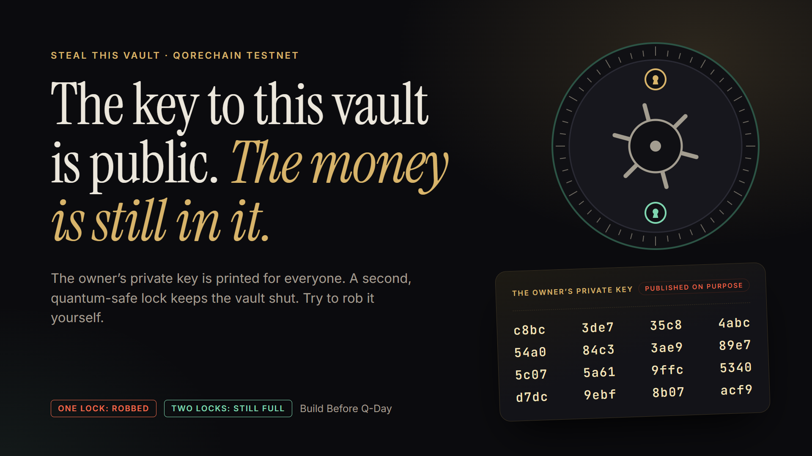

# Steal This Vault

[](https://build.qorechain.io/p/steal-this-vault)

**The key to this vault is public. The money is still in it.**



A vault on the QoreChain testnet whose owner's private key (the ordinary secp256k1 kind every
wallet uses) is printed on the website and committed in this repository, on purpose. Anyone
can copy it and try to empty the vault. They fail, because the account also has a second,
post-quantum key (ML-DSA-87), and both the chain and the vault contract ask for it.

Next to it sits an identical vault with the second lock switched off. The same published key
robs that one every time.

Built for **Build Before Q-Day**, the QoreChain Developer Fest. Testnet only.

**Live site: <https://steal-this-vault.vercel.app>**

## Why

On Q-Day, a quantum computer can derive an ordinary private key from public data. In effect,
every ordinary key becomes a published key. This project skips the wait: the key is published
today, and the page shows, with live chain data, what still protects the money.

## Try it

**On the site.** Open <https://steal-this-vault.vercel.app>, go to the attack lab and press *Run all*. Your browser signs each attempt
with the published key and sends it to the live testnet. Nothing is recorded or replayed.

**From a terminal.**

```sh
git clone https://github.com/MariaSherlin-A/steal-this-vault
cd steal-this-vault
npm install
npm run heist            # all 18 attacks with the published key
npm run heist -- --list  # what each one does
npm run status           # both vaults and the owner's window, read from the chain
```

No account, wallet or coins are needed for either. The key is in
[core/src/published.ts](core/src/published.ts).

## What is on chain

Network: QoreChain testnet `qorechain-diana`, EVM chain id `9800`.

| What | Address |
|---|---|
| Owner account (its key is public) | `0xA2E46aDeDADD7163b4178Bb07AA086765e55dd73` / `qor15tjx4hk6m4ck8dqh3wc84gyxwe09thtnfj6z7w` |
| Hybrid vault, `postQuantum = true` | `0x877BA271d7BdFdb7dfA0BB5863E9FBF04885c483` |
| Control vault, `postQuantum = false` | `0x57AD197DcfDbb76EDE44B0f3c239965Fae0A8F51` |
| `pqcVerify` precompile | `0x0000000000000000000000000000000000000A01` |
| `pqcKeyStatus` precompile | `0x0000000000000000000000000000000000000A02` |

Explorer: <https://explore.qore.network>. The full record is in
[deployments/testnet.json](deployments/testnet.json).

## How it holds

Three checks stand between the published key and the money. A thief has to pass all three.

1. **The native lane.** The owner registered an ML-DSA-87 key with proof of possession. From
   then on the chain rejects any native transaction from the account that lacks the hybrid
   signature (`pqc` code 20). That covers sending coins, replacing the key, granting
   permissions and opening the EVM window.
2. **The EVM lane.** Ordinary secp256k1 transactions (what MetaMask sends) are admitted only
   inside an *EVM authorisation window*, which the owner opens with a hybrid signature and
   scopes to the two vault addresses. Transfers, approvals, deployments and EIP-7702
   delegations go somewhere else, so the chain refuses them.
3. **The vault.** Inside the window the thief can call the vault as the owner. `Vault.withdraw`
   then reads the owner's ML-DSA-87 key from `pqcKeyStatus` and verifies a signature over the
   withdrawal intent with `pqcVerify`. The intent binds chain id, vault address, recipient,
   amount, nonce and deadline, so a real signature cannot be replayed or pointed elsewhere.

The vault does not revert on a bad attempt. It **counts** it, with the reason, in its own
storage. When the classical check passes and the post-quantum check fails, it also adds the
amount to `counterfactualLoss`: what a one-signature vault would have paid. Those counters are
what the site shows.

More detail: [docs/architecture.md](docs/architecture.md),
[docs/threat-model.md](docs/threat-model.md) and the QCAI audit in [docs/AUDIT.md](docs/AUDIT.md).

## The 18 attacks

| Group | Attempts | Stopped by |
|---|---|---|
| Take the money directly | send coins; sign with a made-up second key; replace the owner's second key; open the EVM window; grant spending rights; consent to EIP-7702 delegation | the chain (native lane) |
| Go through the side door | EVM transfer; token approval; contract deployment; EIP-7702; move funds into the control vault | the chain (window scope); the last one by the vault, which rejects deposits from the owner account |
| Fool the vault | no second signature; random bytes; a self-made ML-DSA-87 key; a relayed call; replay of the owner's last withdrawal; reuse of a real signature for a new recipient | the vault contract |
| The control | rob the one-lock vault | nothing: it pays, as designed |

The catalogue is [core/src/attack-list.ts](core/src/attack-list.ts); the code that runs it is
[core/src/attacks.ts](core/src/attacks.ts). The site and the CLI use the same runner.

## QoreChain features used

- ML-DSA-87 key registration with proof of possession (`MsgRegisterPQCKeyV2`)
- Hybrid signatures on native transactions (secp256k1 + ML-DSA-87)
- EVM authorisation windows with `allowedTargets`
- The `pqcVerify` and `pqcKeyStatus` precompiles, called from Solidity
- QoreX wallet: connect, and `signAndBroadcast` for a visitor's own hybrid payment into the vault
- Kits: `@qorechain/sdk`, `@qorechain/pqc`, `@qorechain/evm`, `@qorechain/qorex-types`,
  `@qorechain/qorex-wallet-mock` (development only), `create-qorechain-dapp` (pinned as a
  reference; the site was then written by hand)

## Repository

| Folder | What it is |
|---|---|
| [contracts/](contracts/) | `Vault`, `HybridAuth`, `QorePQC`, an example `HybridAccount`, and their tests |
| [core/](core/) | shared library: chain settings, native and EVM lanes, intents, the attack runner |
| [cli/](cli/) | `heist` (run the attacks) and `status` (read the chain) |
| [keeper/](keeper/) | scheduled job: renews the window, proves the vault pays its owner, refills the control vault |
| [web/](web/) | the site (React, Vite, plain CSS) |
| [spikes/](spikes/) | the first proof scripts, kept as evidence |
| [docs/](docs/) | architecture, threat model, AI build log |

## Commands

| Command | What it does |
|---|---|
| `npm run dev` | the site at <http://localhost:5173> |
| `npm run heist` | every attack, from a terminal (`--list`, `--only <ids>`, `--record`, `--json`) |
| `npm run status` | both vaults, the owner account and its window (`--json`) |
| `npm run check` | compile contracts, typecheck, lint, all unit tests |
| `npm run keeper -- --dry` | what the keeper would do now, without doing it |
| `npm run keeper` | one keeper tick (needs the secrets in `.env`) |

Node 20 or newer.

## How it was tested

- **Unit tests** (`npm test`). The contract tests run on a local EVM that executes a real
  ML-DSA-87 implementation at the precompile addresses, so signatures are genuinely verified,
  not mocked to true or false. They cover every refusal reason, replay and redirection, key
  rotation, reentrancy, accounting, and the two-vault experiment.
- **Live testnet.** Both vaults are deployed. `npm run heist` and the site's attack lab were
  run against them: 17 attempts refused, the control vault paid. The transactions and
  counters are public on the explorer.

## Honest limits

- **Testnet only.** The two precompiles exist on the testnet and not yet on mainnet. The owner
  account has never held real funds and must never.
- **What it proves.** That the classical key alone is not enough on this chain. It does not
  test ML-DSA-87 against a real quantum computer; that rests on the NIST standard (FIPS 204).
- **Fee griefing.** Attempts recorded on chain are paid from the owner's fee allowance inside
  the window. A visitor can use that allowance up. The vault's money is not at risk; the lab
  then checks attempts with `eth_call` and labels them as not recorded.
- **Keeper dependency.** If the keeper stops, the window expires. The vault becomes harder to
  reach, not easier, but vault-level attempts are then refused earlier, by the chain.
- **One mnemonic.** Both of the owner's keys derive from one mnemonic. If it leaked, the vault
  would fall. It lives only in `.env` (ignored by git) and in GitHub Actions secrets.

## Credits

- QoreChain kits listed above
- [viem](https://viem.sh), [React](https://react.dev), [Vite](https://vite.dev),
  [OpenZeppelin Contracts](https://www.openzeppelin.com/contracts), solc, EthereumJS (local
  test EVM), cosmjs-types (test only), TypeScript, ESLint
- Fonts: Instrument Serif, Inter, JetBrains Mono (SIL Open Font License)
- Icons: "Sharp Line - Free" by [Streamline](https://www.streamlinehq.com/), CC BY 4.0

## Licence

MIT. See [LICENSE](LICENSE).
